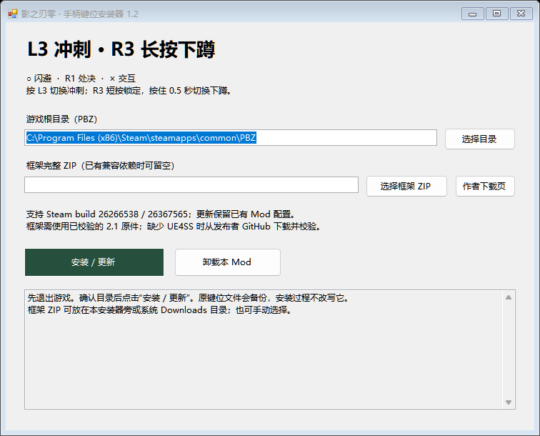

# PBZ L3 Sprint Installer

《影之刃零》Windows 手柄键位安装器：**按 L3 切换冲刺，R3 短按锁定、长按下蹲**，同时设置圆圈闪避和 R1 处决。提供中文界面、自动检测 Steam 游戏目录、依赖校验、备份、更新与卸载。

Windows controller-layout installer for **Phantom Blade Zero**. Press L3 to toggle sprint; tap R3 to lock on, or hold it for 0.5 seconds to crouch. Circle dodges and R1 executes. The installer UI and primary documentation are in Chinese.



> **1.2.0 支持范围：** Windows 64 位、Steam build **26266538 / 26367565**。游戏路径须仅包含 ASCII 字符。框架原件需由使用者自行获取；这是联网引导安装器，不是包含全部依赖的离线整合包。

1.2.0 修复游戏更新后 `unsupported executable size` 导致 Mod 停止启动的问题。安装器和 Lua 启动入口会分别校验对应版本的四段原生冲刺代码；未知版本或代码不匹配时停止。**更新会逐字节保留已有 `settings.lua`**，包括 1.0 的三项移动键位配置，其他键位继续继承游戏存档。详见 [新版兼容核验](docs/COMPATIBILITY.md)。

## 键位

| 操作 | PlayStation 手柄按键 |
| --- | --- |
| 切换冲刺 | **按下 L3** |
| 锁定／取消锁定 | **短按 R3 后松开，不足 0.5 秒** |
| 切换下蹲 | **按住 R3 达到 0.5 秒**，不触发短按锁定 |
| 闪避 | **○ 圆圈** |
| 处决／原生武器派生 | **R1** |
| 对应架势处决组合 | **L1 + R1** |
| 跳跃／普通交互 | **× 叉键** |

圆圈长按冲刺会关闭。上表为首次安装的默认配置；更新时沿用现有 Mod 配置。其余攻击、道具、菜单与键盘设置继承原有配置。安装器不改写原生 `EnhancedInputUserSettings.sav`。

## 获取安装器

此仓库提供完整源码。下载仓库后，在 Windows 上运行：

```powershell
.\Build.ps1
```

生成的安装器位于 `build\PBZ-L3Sprint-Setup.exe`。如需生成可分享的 ZIP，运行：

```powershell
.\Package.ps1
```

成品位于 `dist\PBZ-L3Sprint-OneClick-v1.2.0.zip`。构建要求与源码目录说明见下文。

## 首次安装

1. 从游戏菜单正常退出《影之刃零》。
2. 从 [PBZControllerCustomizer 原作者页面](https://www.nexusmods.com/phantombladezero/mods/112?tab=files&file_id=873) 下载 **2.1 完整 ZIP**，不是 Update 升级包或实验版。Nexus Mods 下载可能需要账号。
3. 将框架 ZIP 放在安装器旁，或系统的 `Downloads` 文件夹。也可以在界面中点击“选择框架 ZIP”。已有校验一致的本机依赖时，可以留空。
4. 双击 `PBZ-L3Sprint-Setup.exe`，确认自动检测到的 PBZ 游戏根目录，或手动选择目录。
5. 点击“安装 / 更新”，等待日志显示完成，再启动游戏。

缺少加载器时，安装器会从 [发布者 GitHub](https://github.com/KintaroModding/ue4ss/releases/tag/v3.0.1-1195-g1ceefac8) 下载固定版本的适配包，验证整个 ZIP 和所需文件的 SHA-256。已有兼容加载器会被保留；不兼容或不完整的加载器不会被直接覆盖。

无需手动复制文件，也无需替换原生键位存档。其他手柄改键脚本须先停用并移出 `Mods` 目录，避免重复接管输入。

## 更新、卸载与备份

**更新：** 退出游戏后，在新版安装器中再次点击“安装 / 更新”。安装器仅更新它识别的 PBZL3Sprint，保留已有 `settings.lua`，并备份旧入口及原生键位文件。1.0 的本机依赖会迁移到专用依赖目录；已有受支持的 UE4SS 不需要重新下载。

**卸载：** 退出游戏，打开安装器，确认游戏目录后点击“卸载本 Mod”。自有入口及依赖会被移至备份目录；共享 UE4SS 和其他 Mod 保持原样。

备份位于游戏根目录：

```text
PBZL3SprintBackups/<时间戳>/
```

按安装状态，备份包含旧版自有 Mod、原 `mods.txt`、原生键位文件，以及卸载时移出的自有文件。原生键位文件始终不被安装器改写。安装失败时会尝试回滚；若部分回滚失败，界面会显示原因与备份位置。

## 依赖与版本

| 组件 | 支持版本 | 获取方式 |
| --- | --- | --- |
| 游戏 | Steam build `26266538` / `26367565`，四段原生代码均须匹配 | 使用者自己的游戏安装 |
| PBZControllerCustomizer | **2.1 完整包** | 使用者从原作者下载，安装器按文件校验后读取 |
| PBZ 适配版 UE4SS | `v3.0.1-1195-g1ceefac8` | 已安装的兼容版本，或安装器从发布者 GitHub 下载 |

PBZControllerCustomizer 的框架源码及 UE4SS 二进制**未嵌入本仓库或安装器**。`source/VendorInfo.cs` 只保存文件名和校验值。依赖仍固定为 **2.1**；原作者页面上更新的 2.3 等版本不属于本安装器的依赖范围，请使用指定的历史完整包，或沿用已经校验一致的本机 2.1。

第三方框架有独立的再分发限制。这里发布的是我们编写的安装器、专用入口与配置，不重新发布受限框架。详情见 [第三方来源说明](docs/THIRD-PARTY.txt)。

## 从源码构建

要求：Windows 64 位，以及可用的 **.NET Framework 4.x C# 编译器**：

```text
%WINDIR%\Microsoft.NET\Framework64\v4.0.30319\csc.exe
```

`Build.ps1` 使用系统编译器和框架程序集；构建安装器本身不需要联网、NuGet、Python 或第三方 Mod 原件。若本机不允许直接执行 `.ps1`，可以查看脚本中的 `csc.exe` 参数，在自己的开发环境中构建。

```text
source/
  Installer.cs       中文界面、Steam 检测、依赖校验及安装事务
  SelfTests.cs       模拟目录中的安装、更新、回滚与卸载检查
  VendorInfo.cs      固定依赖的文件名与 SHA-256
  GameCompatibility.cs 安装前核验两个游戏版本的原生冲刺代码
payload/
  main.lua           专用入口，从本机独立依赖目录载入适配器
  settings.lua       本项目的键位与触发方式配置
  native_guard.lua   启动时核验代码，向本机适配器提供对应版本的校验器
docs/
  THIRD-PARTY.txt    第三方来源和许可范围说明
  verification.json 既有验证记录及实际覆盖范围
tests/
  test_lua.py        双版本启动、原生保护、延迟加载及旧配置回归
Build.ps1            构建安装器
Package.ps1          生成可分享 ZIP、源码 ZIP 和校验文件
LICENSE.txt          本项目自有代码的 MIT 许可
```

## 测试与验证范围

1.2.0 记录包含 **34 项安装流程检查**及 **17 项 Lua 检查**；见 [验证记录](docs/verification.json)。覆盖双版本校验、同大小错误代码拒绝、首次安装、重复更新、个人配置保留、原键位备份、失败回滚、卸载保留其他 Mod、依赖校验和路径边界等场景。新版 EXE 的原生代码已只读核验。

**build 26367565 实机加载已通过：** 从原 1.0 配置更新并加载现有存档后，L3 冲刺、R3 短按锁定／长按下蹲的实际有效映射均匹配，原生冲刺状态及动作时间戳可正常读取，未出现入口或运行回滚错误。安装过程保留了原配置、键位存档及 EXE 的完整字节。实体手柄实际按压效果仍待用户确认。

可用安装器的测试入口复核安装流程：

```powershell
.\build\PBZ-L3Sprint-Setup.exe --self-test report.json C:\path\to\PBZControllerCustomizer\Scripts C:\path\to\phantombladezero_ue4ss_v3.0.1-1195-g1ceefac8.zip
```

路径含空格时请加双引号。测试所需框架和加载器原件须自行获取。测试在系统临时目录创建模拟游戏，不向真实游戏安装写入文件，也不联网。

Lua 回归可在装有 Python 3 和 `lupa==2.6` 的测试环境运行：

```powershell
python tests/test_lua.py C:\path\to\PBZControllerCustomizer\Scripts C:\path\to\PBZ\platform\steam\PBZ.exe
```

第二个路径可省略；提供时会额外只读核验当前 build 26367565 的真实 EXE。构建安装器本身不需要这些测试依赖。

**离线检查不等于完整实机验收。** 尚未完成所有手柄、武器、关卡和游戏场景的实机测试；验证记录会明确区分代码核验、模拟运行与实际游戏映射。未来游戏更新仍需要重新核验。

## 常见问题

**找不到游戏目录：** 选择包含 `platform\steam\PBZ.exe` 的 PBZ 根目录。不要选择 Steam 的 `steamapps` 目录或游戏中的 `steam` 子目录。

**提示路径含非 ASCII 字符：** 当前第三方 Lua 框架对文件路径有限制，请使用不含中文等非 ASCII 字符的游戏库路径。

**框架校验失败：** 确认下载的是 PBZControllerCustomizer **2.1 完整包**。升级包缺少文件，其他版本也不符合当前固定校验值。

**已有 UE4SS 不兼容：** 安装器会停止，不会直接替换其他版本。先根据已有 Mod 的要求处理版本兼容问题。

**写入权限不足：** 关闭安装器，以管理员身份重新运行后重试。

**需要查看运行诊断：**

```text
platform/steam/ue4ss/UE4SS.log
platform/steam/ue4ss/PBZL3SprintDependencies/PBZControllerCustomizer/diagnostics.txt
```

反馈问题时，请说明游戏 build、手柄型号、连接方式、现有改键 Mod，以及错误发生在哪一步。

## 许可与致谢

安装器 C# 源码、专用 `main.lua`、`settings.lua` 和自有文档采用 [MIT License](LICENSE.txt)。这项许可不授予游戏或第三方框架的额外权利。

- **Sherkirito / PBZControllerCustomizer**：提供安装器所依赖的原生输入适配器。
- **UE4SS-RE / RE-UE4SS**：上游 UE4SS。
- **KintaroModding**：本项目使用的 PBZ 适配加载器发布包。
